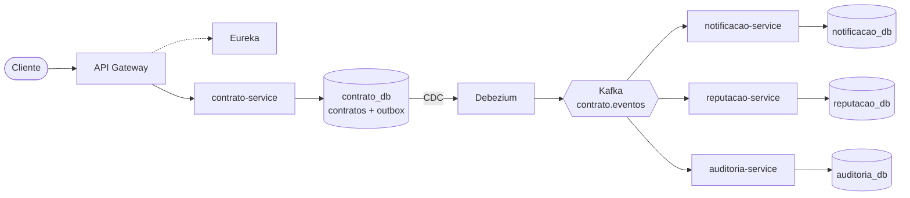

# Freela Marketplace: comunicação orientada a eventos entre microsserviços

## 1. Introdução

O **Freela Marketplace** conecta clientes que possuem demandas de trabalho a profissionais freelancers. O núcleo do sistema é o **contrato** firmado entre as partes, cujo ciclo de vida é gerenciado pelo `contrato-service`. Outros três serviços dependem das mudanças desse ciclo: **notificação**, **reputação** e **auditoria**.

Este trabalho evolui a aplicação base para um modelo **orientado a eventos**. Cada mudança relevante em um contrato passa a ser publicada como um *evento de domínio* no Apache Kafka, e os serviços interessados reagem a ele de forma assíncrona, sem chamadas HTTP diretas a partir do serviço de contratos. Sobre essa base foram adicionados mecanismos de **confiabilidade** (publicação transacional, ordenação, idempotência e tratamento de falhas) e de **observabilidade** (logs centralizados, correlação e rastreamento distribuído).

## 2. Arquitetura da solução

A plataforma é composta por seis aplicações Spring Boot, registradas no **Eureka** e acessadas pelo **API Gateway**. Cada microsserviço possui o **seu próprio banco de dados** em uma instância PostgreSQL (*database per service*), o que preserva a autonomia de cada um.



| Serviço | Porta | Responsabilidade |
|---|---:|---|
| `eureka-server` | 8761 | Registro e descoberta de serviços |
| `api-gateway` | 8080 | Ponto de entrada HTTP; origem do identificador de correlação e do trace |
| `contrato-service` | 8081 | Ciclo de vida do contrato; **produtor** dos eventos |
| `notificacao-service` | 8082 | Registra notificações para cliente e freelancer; **consumidor** |
| `reputacao-service` | 8083 | Mantém indicadores de cada freelancer; **consumidor** |
| `auditoria-service` | 8084 | Registra todos os eventos para consulta posterior; **consumidor** |

O `contrato-service` segue os princípios do **Domain-Driven Design**. O Aggregate `Contrato` concentra as regras de transição de estado e registra os eventos de domínio; as camadas de aplicação e infraestrutura cuidam da persistência e da publicação. A máquina de estados é:

```text
ATIVO ──registrarEntrega──> ENTREGA_REGISTRADA ──concluir──> CONCLUIDO
  └──────────────────cancelar──────────────────> CANCELADO
```

A comunicação é **assíncrona** por três razões: o serviço de contratos não depende da disponibilidade dos demais; novos consumidores podem ser adicionados sem alterar o produtor; e cada serviço escala e falha de forma independente.

## 3. Eventos de domínio e contrato das mensagens

### 3.1 Eventos

| Evento | Gerado por | Efeito na notificação | Efeito na reputação | Auditoria |
|---|---|---|---|---|
| `ContratoCriado` | `POST /api/contratos` | Avisa cliente e freelancer | +1 contrato iniciado | Registra |
| `EntregaRegistrada` | `POST /api/contratos/{id}/entrega` | Avisa o cliente | Nenhum | Registra |
| `ContratoConcluido` | `POST /api/contratos/{id}/conclusao` | Avisa cliente e freelancer | +1 concluído e soma o valor | Registra |
| `ContratoCancelado` | `POST /api/contratos/{id}/cancelamento` | Avisa cliente e freelancer | +1 cancelado | Registra |

### 3.2 Tópicos

| Tópico | Partições | Chave | Produtor | Consumidores |
|---|---:|---|---|---|
| `contrato.eventos` | 3 | `contratoId` | `contrato-service` (via Debezium) | notificação, reputação e auditoria |
| `contrato.eventos.<servico>.DLT` | 3 | `contratoId` | cada consumidor | o próprio consumidor (diagnóstico e reprocessamento) |

Todos os tipos de evento do contrato compartilham **um único tópico**. A escolha é deliberada: o Kafka só garante ordem dentro de uma partição, e tópicos separados por tipo permitiriam que `ContratoConcluido` fosse consumido antes de `ContratoCriado`.

### 3.3 Estrutura da mensagem

Todas as mensagens seguem o mesmo envelope JSON. A **chave** é o `contratoId`.

| Campo | Obrigatório | Descrição |
|---|:---:|---|
| `eventId` | sim | UUID único do evento, usado para idempotência |
| `eventType` | sim | Tipo do evento (tabela 3.1) |
| `eventVersion` | sim | Versão do formato (atual: 1) |
| `occurredAt` | sim | Data e hora do evento (ISO-8601, UTC) |
| `contratoId` | sim | Contrato relacionado |
| `correlationId` | sim* | Identificador de correlação da operação |
| `source` | sim | Serviço de origem |
| `payload` | sim | `clienteId`, `freelancerId`, `titulo`, `valor` e `status` do contrato após o evento |

\* Sempre presente em operações iniciadas pelo Gateway.

Além do valor, a mensagem leva os headers `eventType`, `contratoId`, `correlationId` e `traceparent` (contexto de rastreamento no padrão W3C). Exemplo de um `ContratoConcluido`:

```json
{
  "eventId": "4aa45960-bb9e-4eab-a337-5055f03b7b00",
  "eventType": "ContratoConcluido",
  "eventVersion": 1,
  "occurredAt": "2026-10-13T02:52:31.901Z",
  "contratoId": "7f2bcb0a-91ba-4cbb-aef2-25a21753eeb8",
  "correlationId": "evid-20261012235231-conclusao",
  "source": "contrato-service",
  "payload": {
    "clienteId": "11111111-1111-1111-1111-111111111111",
    "freelancerId": "eeeeeeee-eeee-eeee-eeee-000000235231",
    "titulo": "Construção de API de pagamentos",
    "valor": 3500.00,
    "status": "CONCLUIDO"
  }
}
```

Os quatro eventos têm a mesma estrutura; muda apenas o `eventType` e o `payload.status` (`ATIVO`, `ENTREGA_REGISTRADA`, `CONCLUIDO` ou `CANCELADO`). Os consumidores ignoram campos desconhecidos (*tolerant reader*), o que permite evoluir o formato sem quebrar a compatibilidade, e rejeitam mensagens sem os campos obrigatórios.

## 4. Padrões de confiabilidade

### 4.1 Publicação transacional: Transactional Outbox com Debezium

**Problema.** Salvar o contrato no banco e publicar o evento no Kafka são duas operações em sistemas distintos, sem transação comum. Se a publicação ocorrer após o commit, uma falha entre as duas perde o evento; se ocorrer antes, um rollback publica algo que não aconteceu (*dual write*).

**Solução.** O evento é gravado na tabela `outbox_eventos`, **na mesma transação** que altera o contrato. Um processo independente, o **Debezium**, lê o log de transações do PostgreSQL (*Change Data Capture*, com `wal_level=logical`) e publica cada novo registro no Kafka por meio do *Outbox Event Router*. Assim, ou o contrato e o evento existem juntos, ou nenhum dos dois existe; e um evento confirmado no banco sempre chega ao Kafka, mesmo que o serviço caia logo depois.

Na implementação, o `ContratoApplicationService` executa a transição no Aggregate e, dentro da mesma transação, o `OutboxEventoAdapter` grava o evento. Esse adapter só aceita ser executado dentro de uma transação existente (`Propagation.MANDATORY`). O conector está definido em `infra/debezium/contrato-outbox-connector.json` e é registrado automaticamente ao subir o ambiente.

### 4.2 Processamento concorrente com ordem por contrato

A ordem é garantida em três pontos:

1. **Na origem**: as transições de um mesmo contrato usam *lock* pessimista, então os eventos entram no log do banco na mesma ordem em que ocorreram no domínio.
2. **No broker**: a chave da mensagem é o `contratoId`. Todos os eventos de um contrato vão para a mesma partição, que o Kafka entrega em ordem. O produtor do Debezium é idempotente (`acks=all`), então reenvios não alteram essa ordem.
3. **No consumo**: cada consumidor usa `concurrency: 3`, **uma thread por partição**. Contratos em partições diferentes são processados em paralelo, enquanto os eventos de uma mesma partição são processados um de cada vez, com o offset confirmado somente após o processamento (`ack-mode: record`).

O resultado é paralelismo entre contratos diferentes, sem que uma sequência como `ContratoCriado → EntregaRegistrada → ContratoConcluido` seja processada fora de ordem.

### 4.3 Idempotência

Como a entrega é do tipo *at-least-once*, uma mensagem pode chegar mais de uma vez (por exemplo, após um rebalanceamento ou reprocessamento). Cada consumidor usa o **`eventId`** para reconhecer eventos já processados:

- **Notificação e reputação** gravam o `eventId` na tabela `eventos_processados`, na mesma transação da alteração de negócio. Se o `eventId` já existe, o evento é descartado.
- **Auditoria** usa o próprio registro, que tem o `eventId` como campo único.
- **Constraints únicas** no banco funcionam como segunda barreira, caso duas entregas da mesma mensagem cheguem ao mesmo tempo.

Assim, o reprocessamento não duplica registros, não incrementa contadores, não repete notificações e não altera dados já atualizados pelo mesmo evento.

### 4.4 Tratamento de falhas

- **Falhas transitórias** (por exemplo, banco indisponível) recebem até **3 retentativas com intervalo exponencial** (1s, 2s, 4s).
- **Mensagens inválidas** (JSON malformado ou sem campos obrigatórios) não são retentadas, porque o erro não se resolveria sozinho.
- Esgotadas as tentativas, a mensagem vai para o **Dead Letter Topic** do serviço (`contrato.eventos.<servico>.DLT`), com headers que registram a exceção, o motivo e a partição/offset de origem. O consumidor segue para as próximas mensagens; outras partições e outros serviços não são afetados.
- As mensagens na DLT podem ser consultadas em `GET /api/<servico>/dlt` e reprocessadas em `POST /api/<servico>/dlt/reprocessar`. O que falhar novamente volta para a DLT, permanecendo disponível para diagnóstico.

Para demonstração, a variável `SIMULAR_FALHA_TITULO` faz um consumidor falhar em eventos cujo título contenha o texto informado. Ela fica desligada por padrão.

## 5. Observabilidade

### 5.1 Logs estruturados

Todos os serviços usam a mesma configuração de log (`logback-spring.xml`). Cada linha carrega automaticamente o contexto da execução:

```text
2026-10-12 23:52:32.105 INFO service=notificacao-service traceId=6acd9cef... spanId=... correlationId=evid-...-criar contratoId=7f2bcb0a-... eventId=5a68e2e0-... - notificacao.registro.inicio ...
```

As mensagens indicam o início e o fim de cada etapa (`*.inicio`, `*.sucesso`), as mensagens recebidas e processadas (`kafka.mensagem.recebida`, `kafka.mensagem.processada`), as duplicatas e as falhas (`kafka.mensagem.falha`, `kafka.mensagem.retentativa`, `kafka.mensagem.dlt`).

**Dados sensíveis** não são registrados: os logs contêm apenas identificadores, tipos e resultados (título e valores do contrato ficam de fora). Como proteção adicional, e-mails, CPFs e tokens são mascarados (`****`) antes do envio à central de logs.

### 5.2 Centralização de logs com ELK

Os serviços enviam os logs em JSON ao **Logstash**, que os indexa no **Elasticsearch**. A consulta é feita no **Kibana** (`http://localhost:5601`, *data view* "Freela - Logs dos microsservicos", criado automaticamente). Uma única busca reúne os logs de todos os serviços envolvidos numa operação:

```text
correlationId : "teste-contrato-001"
contratoId    : "<id do contrato>"
eventId       : "<id do evento>"
```

### 5.3 Rastreamento distribuído com Zipkin

O **Spring Cloud Sleuth**, citado na disciplina, foi descontinuado e não é compatível com o Spring Boot 3 ou superior. Como o projeto usa o Spring Boot 4.1, foi adotado o seu sucessor oficial, o **Micrometer Tracing** (com Brave), que mantém os mesmos conceitos de trace, span e propagação, e exporta os dados para o **Zipkin** (`http://localhost:9411`).

O desafio estava no trecho assíncrono: quem publica no Kafka é o Debezium, não a aplicação, então o contexto de rastreamento não seria propagado sozinho. A solução foi gravar o contexto do trace (`traceparent`) na própria tabela de Outbox. O Debezium o transforma em header da mensagem, e os consumidores continuam o mesmo trace:

```text
[api-gateway]           http post
  [contrato-service]    http post /api/contratos
    [contrato-service]  PRODUCER contrato.eventos outbox ContratoCriado
      [notificacao-service] CONSUMER contrato.eventos process
      [reputacao-service]   CONSUMER contrato.eventos process
      [auditoria-service]   CONSUMER contrato.eventos process
```

### 5.4 Correlação das operações

O **API Gateway** recebe o header `X-Correlation-Id` (ou gera um UUID, se ausente) e o repassa ao `contrato-service`, que o grava no evento. Os consumidores o leem da mensagem. Assim, a mesma identificação acompanha a operação por todo o caminho (**Gateway → contrato-service → Kafka → consumidores**) e está disponível nos logs, nas mensagens, nas tags dos spans do Zipkin e nos registros de auditoria.

## 6. Execução

### 6.1 Infraestrutura

Requisitos: Docker (com cerca de 6 GB de memória disponível) e JDK 21 ou superior.

```bash
cd infra
docker compose up -d
```

O `docker-compose.yml` sobe o PostgreSQL (bancos separados por serviço), o Kafka em modo **KRaft**, o Debezium, o Kafka UI, o ELK e o Zipkin. Containers auxiliares criam os tópicos, registram o conector do Debezium e configuram o Kibana; eles terminam com `Exited (0)` após a inicialização. Para verificar o estado: `docker compose ps -a`. Para encerrar: `docker compose down` (com `-v` para apagar os dados).

| Interface | Endereço |
|---|---|
| Eureka | http://localhost:8761 |
| Kafka UI | http://localhost:8090 |
| Kibana | http://localhost:5601 |
| Zipkin | http://localhost:9411 |

### 6.2 Aplicações

**IntelliJ IDEA:** abra a pasta raiz como projeto Maven e execute a classe principal de cada módulo, começando pelo Eureka: `EurekaServerApplication`, `ApiGatewayApplication`, `ContratoApplication`, `NotificacaoApplication`, `ReputacaoApplication` e `AuditoriaApplication`.

**Maven:** a partir da raiz, um terminal por serviço, por exemplo:

```bash
mvn -pl contrato-service spring-boot:run
```

### 6.3 Exemplos de chamadas

```bash
curl -X POST http://localhost:8080/api/contratos -H 'Content-Type: application/json' -H 'X-Correlation-Id: teste-contrato-001' -d '{"clienteId":"11111111-1111-1111-1111-111111111111","freelancerId":"22222222-2222-2222-2222-222222222222","titulo":"Construção de API de pagamentos","valor":3500.00}'
```

```bash
curl -X POST http://localhost:8080/api/contratos/{id}/entrega
```

```bash
curl -X POST http://localhost:8080/api/contratos/{id}/conclusao
```

```bash
curl "http://localhost:8080/api/auditoria?correlationId=teste-contrato-001"
```

Também estão disponíveis `POST /api/contratos/{id}/cancelamento`, `GET /api/notificacoes?contratoId={id}`, `GET /api/reputacoes/{freelancerId}` e `GET /api/auditoria` (com os filtros `eventId`, `contratoId`, `correlationId` e `eventType`). No PowerShell, use `curl.exe`.

## 7. Testes automatizados

Os 23 testes (`mvn test`) usam banco H2 e Kafka embarcado, sem depender do Docker. Eles verificam:

- as regras do Aggregate e a gravação do contrato e do evento na mesma transação;
- o processamento de cada consumidor;
- que mensagens repetidas não geram efeitos duplicados;
- que 12 contratos enviados em paralelo são processados por mais de uma thread, cada um na ordem correta;
- que uma mensagem inválida vai para a DLT sem bloquear as seguintes, que uma falha transitória se recupera nas retentativas e que uma mensagem na DLT pode ser reprocessada.

## 8. Evidências da execução

As evidências abaixo são trechos de uma execução real do script `scripts/gerar-evidencias.sh`, que reproduz todos os fluxos pelo Gateway (`bash scripts/gerar-evidencias.sh`; no Windows, pelo Git Bash).

**1. Requisição recebida pelo API Gateway.** O contrato foi criado e o identificador de correlação foi devolvido:

```text
HTTP/1.1 201 Created
X-Correlation-Id: evid-20261012235231-criar
{"id":"7f2bcb0a-91ba-4cbb-aef2-25a21753eeb8", ..., "status":"ATIVO"}
```

**2. Alteração persistida no contrato-service.** Após entrega e conclusão, o contrato está `CONCLUIDO` e a tabela de Outbox contém os três eventos, com correlação e contexto de trace:

```text
 id                                   | status
 7f2bcb0a-91ba-4cbb-aef2-25a21753eeb8 | CONCLUIDO

 type              | correlation_id                | traceparent
 ContratoCriado    | evid-20261012235231-criar     | 00-6acd9cef36d1c9842acbd09d04c...
 EntregaRegistrada | evid-20261012235231-entrega   | 00-6acd9cf0bc8b70636fe3b42fcd0...
 ContratoConcluido | evid-20261012235231-conclusao | 00-6acd9cf0218960a4f3263ffecaa...
```

**3. Eventos publicados no Kafka.** Os três eventos estão no tópico `contrato.eventos`, na mesma partição e em sequência, com chave `7f2bcb0a-...`:

```text
Partition:0  Offset:44  eventType:ContratoCriado     correlationId:evid-...-criar
Partition:0  Offset:45  eventType:EntregaRegistrada  correlationId:evid-...-entrega
Partition:0  Offset:46  eventType:ContratoConcluido  correlationId:evid-...-conclusao
```

**4. Consumo pelos serviços interessados.** Os três grupos de consumidores leram todas as partições (lag 0):

```text
GROUP                PARTITION  CURRENT-OFFSET  LOG-END-OFFSET  LAG
notificacao-service  0          47              47              0
reputacao-service    0          47              47              0
auditoria-service    0          47              47              0
```

**5. Persistência realizada pelos consumidores.** Cada serviço gravou o resultado no próprio banco:

```text
notificacao_db: CLIENTE/ContratoCriado, FREELANCER/ContratoCriado, CLIENTE/EntregaRegistrada,
                CLIENTE/ContratoConcluido, FREELANCER/ContratoConcluido
reputacao_db:   contratosIniciados=1, contratosConcluidos=1, valorTotal=3500.00
auditoria_db:   ContratoCriado(P0@44) EntregaRegistrada(P0@45) ContratoConcluido(P0@46)
```

**6. Tratamento de mensagem duplicada.** A mensagem `ContratoConcluido` foi reenviada duas vezes ao tópico. O evento passou a aparecer três vezes, mas o estado dos consumidores não mudou e os logs registram o descarte:

```text
eventId 4aa45960-... no tópico: offsets 46, 47 e 48

ANTES  -> contratosConcluidos=1, valorTotal=3500.00, notificacoes=5, auditoria=3
DEPOIS -> contratosConcluidos=1, valorTotal=3500.00, notificacoes=5, auditoria=3

reputacao-service    reputacao.evento.duplicado   eventId=4aa45960-... (2x)
notificacao-service  notificacao.evento.duplicado eventId=4aa45960-... (2x)
auditoria-service    auditoria.evento.duplicado   eventId=4aa45960-... (2x)
```

**7. Manutenção da ordem por contrato.** Seis contratos tiveram o ciclo completo executado em paralelo. Eles foram distribuídos entre partições, e cada um manteve a sequência correta:

```text
be0a866b  ContratoCriado(P2@35) EntregaRegistrada(P2@38) ContratoConcluido(P2@40)
4bec3c8a  ContratoCriado(P1@30) EntregaRegistrada(P1@33) ContratoConcluido(P1@36)
e07c438c  ContratoCriado(P1@31) EntregaRegistrada(P1@34) ContratoConcluido(P1@37)
ee1c726e  ContratoCriado(P2@36) EntregaRegistrada(P2@39) ContratoConcluido(P2@42)
64135ed3  ContratoCriado(P1@32) EntregaRegistrada(P1@35) ContratoConcluido(P1@38)
cfd0e763  ContratoCriado(P2@37) EntregaRegistrada(P2@41) ContratoConcluido(P2@43)
```

**8. Logs da operação consultados de forma centralizada.** A busca por `correlationId=evid-20261012235231-criar` no Elasticsearch retornou 25 logs de cinco serviços, em ordem cronológica, atravessando o Kafka (trecho):

```text
02:52:31.607  api-gateway          gateway.request.inicio
02:52:31.616  contrato-service     contrato.dominio.criado
02:52:31.622  contrato-service     outbox.evento.registrado
02:52:31.632  api-gateway          gateway.request.fim status=201
02:52:32.099  auditoria-service    kafka.mensagem.recebida partition=0 offset=44
02:52:32.100  reputacao-service    kafka.mensagem.recebida partition=0 offset=44
02:52:32.100  notificacao-service  kafka.mensagem.recebida partition=0 offset=44
02:52:32.107  notificacao-service  notificacao.registro.sucesso
02:52:32.110  reputacao-service    reputacao.atualizacao.sucesso
02:52:32.111  auditoria-service    auditoria.registro.sucesso
```

**9. Trace correspondente no Zipkin.** A mesma operação gerou um trace com a participação dos cinco serviços (`traceId 6acd9cef36d1c9842acbd09d04c6d8a9`). O mesmo `traceId` aparece nos 25 logs do item anterior:

```text
[api-gateway]          SERVER   http post
[api-gateway]          CLIENT   http post
[contrato-service]     SERVER   http post /api/contratos
[contrato-service]     PRODUCER contrato.eventos outbox ContratoCriado
[notificacao-service]  CONSUMER contrato.eventos process
[reputacao-service]    CONSUMER contrato.eventos process
[auditoria-service]    CONSUMER contrato.eventos process
```

**10. Mensagem com erro preservada para diagnóstico.** Uma mensagem malformada foi enviada para a DLT sem retentativas, com a origem e o motivo registrados:

```text
key=evid-20261012235231-poison  particaoOriginal=1  offsetOriginal=39
excecao=EventoInvalidoException  motivo="Mensagem com JSON inválido"  pendente=true
```

## 9. Considerações finais

A solução atende aos requisitos propostos da seguinte forma:

| Requisito | Seção |
|---|---|
| Microsserviços com Gateway, Eureka e banco por serviço | 2 |
| Eventos de domínio publicados no Kafka, sem HTTP entre contrato e auxiliares | 2, 3 |
| Especificação das mensagens (tópico, produtor, consumidores, chave, campos, exemplo) | 3 |
| Publicação transacional | 4.1 |
| Concorrência com ordem por contrato | 4.2 e evidência 7 |
| Idempotência | 4.3 e evidência 6 |
| Falhas, DLT e reprocessamento | 4.4 e evidência 10 |
| Logs padronizados e sem dados sensíveis | 5.1 |
| Logs centralizados | 5.2 e evidência 8 |
| Rastreamento distribuído no Zipkin | 5.3 e evidência 9 |
| Correlação ponta a ponta | 5.4 |

Algumas limitações são conhecidas e aceitas para o escopo do trabalho. Durante as retentativas, as mensagens seguintes **da mesma partição** aguardam alguns segundos; esse é o custo de preservar a ordem. A tabela de Outbox não é expurgada. E o ambiente local não tem autenticação no Elasticsearch nem persistência no Zipkin.
