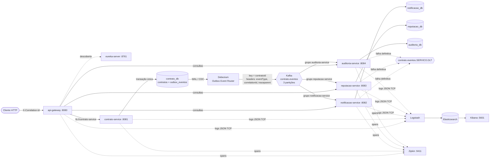
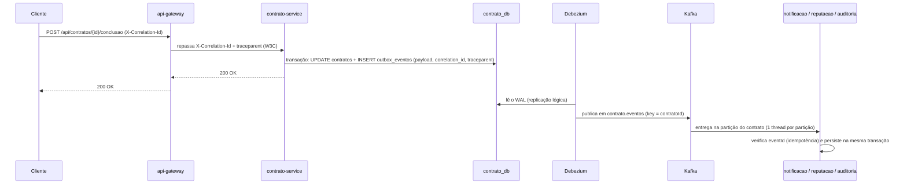

# Freela Marketplace

Marketplace de contratação de freelancers construído com microsserviços em Java/Spring, evoluído para um modelo **orientado a eventos** com Apache Kafka, publicação transacional (Outbox + Debezium), processamento concorrente com preservação de ordem, idempotência, tratamento de falhas com DLT, logs centralizados no ELK e rastreamento distribuído no Zipkin.

## Sumário

1. [Visão geral da arquitetura](#1-visão-geral-da-arquitetura)
2. [Serviços participantes](#2-serviços-participantes)
3. [Domínio e API](#3-domínio-e-api)
4. [Comunicação baseada em eventos](#4-comunicação-baseada-em-eventos)
5. [Especificação das mensagens](#5-especificação-das-mensagens)
6. [Publicação transacional (Outbox + Debezium)](#6-publicação-transacional-outbox--debezium)
7. [Particionamento, concorrência e ordem](#7-particionamento-concorrência-e-ordem)
8. [Idempotência](#8-idempotência)
9. [Tratamento de falhas e DLT](#9-tratamento-de-falhas-e-dlt)
10. [Logs da aplicação](#10-logs-da-aplicação)
11. [Centralização de logs (ELK)](#11-centralização-de-logs-elk)
12. [Rastreamento distribuído (Zipkin)](#12-rastreamento-distribuído-zipkin)
13. [Correlação das operações](#13-correlação-das-operações)
14. [Infraestrutura](#14-infraestrutura)
15. [Execução das aplicações](#15-execução-das-aplicações)
16. [Exemplos de chamadas](#16-exemplos-de-chamadas)
17. [Testes automatizados](#17-testes-automatizados)
18. [Evidências da execução](#18-evidências-da-execução)
19. [Atendimento aos requisitos](#19-atendimento-aos-requisitos)
20. [Decisões e limitações conhecidas](#20-decisões-e-limitações-conhecidas)
21. [Tecnologias](#21-tecnologias)

---

## 1. Visão geral da arquitetura

O `contrato-service` é o dono do ciclo de vida do contrato (Aggregate `Contrato`). Cada mudança relevante gera um **evento de domínio**, gravado na tabela `outbox_eventos` **na mesma transação** do contrato. O **Debezium** lê essa tabela por CDC (replicação lógica do PostgreSQL) e publica os eventos no tópico Kafka `contrato.eventos`, usando o `contratoId` como chave.

Os serviços auxiliares (`notificacao-service`, `reputacao-service` e `auditoria-service`) consomem o tópico de forma assíncrona, cada um com seu próprio grupo de consumidores e seu próprio banco. **Não há chamadas HTTP do `contrato-service` para os serviços auxiliares.**



Fluxo de uma operação, ponta a ponta:



## 2. Serviços participantes

| Serviço | Porta | Banco | Responsabilidade | Papel no Kafka |
|---|---:|---|---|---|
| `eureka-server` | 8761 | - | Registro e descoberta de serviços | - |
| `api-gateway` | 8080 | - | Ponto de entrada HTTP, geração/propagação do `X-Correlation-Id`, início do trace | - |
| `contrato-service` | 8081 | `contrato_db` | Ciclo de vida do contrato (Aggregate, DDD) e Outbox | **Produtor** (via Outbox + Debezium) |
| `notificacao-service` | 8082 | `notificacao_db` | Registra notificações para cliente e freelancer | Consumidor (`notificacao-service`) |
| `reputacao-service` | 8083 | `reputacao_db` | Mantém contadores e valor total por freelancer | Consumidor (`reputacao-service`) |
| `auditoria-service` | 8084 | `auditoria_db` | Registra todos os eventos processados para consulta | Consumidor (`auditoria-service`) |

Cada microsserviço tem **seu próprio banco** na instância PostgreSQL e não acessa o banco dos outros. A integração entre o `contrato-service` e os auxiliares é exclusivamente por eventos.

## 3. Domínio e API

O `contrato-service` segue uma organização inspirada em DDD:

```text
contrato-service/src/main/java/br/com/freela/contrato
├── application                  casos de uso (ContratoApplicationService) e porta EventoOutbox
├── domain
│   ├── event                    ContratoCriado, EntregaRegistrada, ContratoConcluido, ContratoCancelado
│   ├── model                    Aggregate Contrato e StatusContrato
│   ├── repository               porta ContratoRepository
│   └── shared                   DomainEvent
└── infrastructure
    ├── messaging                Outbox (entidade, adapter, envelope EventoIntegracao), tópicos
    ├── persistence              adapter JPA (com lock pessimista para transições)
    └── web                      controller, CorrelationIdFilter, tratamento de erros
```

Máquina de estados do contrato:

```text
ATIVO ──registrarEntrega──> ENTREGA_REGISTRADA ──concluir──> CONCLUIDO
  │                                │
  └────────────cancelar────────────┴──> CANCELADO
```

Transições inválidas retornam **409 Conflict**, contrato inexistente retorna **404 Not Found** e requisição inválida retorna **400 Bad Request** (formato `ProblemDetail`).

| Método | Caminho (via Gateway) | Serviço | Descrição |
|---|---|---|---|
| POST | `/api/contratos` | contrato | Cria contrato → `ContratoCriado` |
| POST | `/api/contratos/{id}/entrega` | contrato | Registra entrega → `EntregaRegistrada` |
| POST | `/api/contratos/{id}/conclusao` | contrato | Conclui → `ContratoConcluido` |
| POST | `/api/contratos/{id}/cancelamento` | contrato | Cancela → `ContratoCancelado` |
| GET | `/api/contratos`, `/api/contratos/{id}` | contrato | Consulta |
| GET | `/api/notificacoes?contratoId=` | notificação | Notificações (filtro opcional) |
| GET | `/api/reputacoes`, `/api/reputacoes/{freelancerId}` | reputação | Reputação dos freelancers |
| GET | `/api/auditoria?eventId=&contratoId=&correlationId=&eventType=` | auditoria | Registros de auditoria (filtros opcionais e combináveis) |
| GET | `/api/{notificacoes\|reputacoes\|auditoria}/dlt` | consumidores | Mensagens na DLT do serviço, com motivo e origem |
| POST | `/api/{notificacoes\|reputacoes\|auditoria}/dlt/reprocessar` | consumidores | Reprocessa as mensagens pendentes da DLT |

## 4. Comunicação baseada em eventos

### Tópicos Kafka

| Tópico | Partições | Chave | Produtor | Consumidores |
|---|---:|---|---|---|
| `contrato.eventos` | 3 | `contratoId` | `contrato-service` (via Debezium) | `notificacao-service`, `reputacao-service`, `auditoria-service` |
| `contrato.eventos.notificacao.DLT` | 3 | `contratoId` (original) | `notificacao-service` | diagnóstico / reprocessamento do próprio serviço |
| `contrato.eventos.reputacao.DLT` | 3 | `contratoId` (original) | `reputacao-service` | diagnóstico / reprocessamento do próprio serviço |
| `contrato.eventos.auditoria.DLT` | 3 | `contratoId` (original) | `auditoria-service` | diagnóstico / reprocessamento do próprio serviço |

Os tópicos são criados pelo container `freela-kafka-init` (`infra/kafka/create-topics.sh`) e também declarados nas aplicações como `NewTopic` (`KafkaTopicosConfig` no `contrato-service` e `KafkaErrorHandlingConfig` nos consumidores).

Um **único tópico** para todos os eventos do contrato é intencional: o Kafka só garante ordem dentro de uma partição de um tópico. Com tópicos separados por tipo de evento, `ContratoCriado`, `EntregaRegistrada` e `ContratoConcluido` de um mesmo contrato poderiam ser consumidos fora de ordem.

### Por que assíncrono

- O `contrato-service` não depende da disponibilidade dos serviços auxiliares: se a notificação estiver fora do ar, o contrato é criado normalmente e o evento é consumido quando o serviço voltar.
- Novos consumidores podem ser adicionados sem alterar o produtor.
- Cada consumidor evolui, escala e falha de forma independente (grupos de consumidores separados).

### Produtores e consumidores por evento

| Evento | notificacao-service | reputacao-service | auditoria-service |
|---|---|---|---|
| `ContratoCriado` | notifica **cliente** e **freelancer** | `contratosIniciados + 1` | registra |
| `EntregaRegistrada` | notifica **cliente** | sem efeito (registrado como processado) | registra |
| `ContratoConcluido` | notifica **cliente** e **freelancer** | `contratosConcluidos + 1`, `valorTotal + valor` | registra |
| `ContratoCancelado` | notifica **cliente** e **freelancer** | `contratosCancelados + 1` | registra |

## 5. Especificação das mensagens

Esta seção é o **contrato de comunicação** entre o `contrato-service` e os consumidores.

### Envelope comum (valor da mensagem, JSON UTF-8)

| Campo | Tipo | Obrigatório | Descrição |
|---|---|:---:|---|
| `eventId` | UUID | sim | Identificador único do evento. Usado para **idempotência** nos consumidores. |
| `eventType` | string | sim | `ContratoCriado`, `EntregaRegistrada`, `ContratoConcluido` ou `ContratoCancelado`. |
| `eventVersion` | inteiro | sim | Versão do contrato da mensagem (atual: `1`). |
| `occurredAt` | ISO-8601 (UTC) | sim | Data/hora em que o evento ocorreu no domínio. |
| `contratoId` | UUID | sim | Contrato relacionado (também é a **chave** da mensagem). |
| `correlationId` | string | não* | Identificador de correlação da operação iniciada no Gateway. |
| `source` | string | sim | Serviço de origem (`contrato-service`). |
| `payload` | objeto | sim | Dados do contrato necessários aos consumidores. |
| `payload.clienteId` | UUID | sim | Cliente do contrato (destinatário de notificações). |
| `payload.freelancerId` | UUID | sim | Freelancer do contrato (destinatário e chave da reputação). |
| `payload.titulo` | string | sim | Título do trabalho (usado no texto da notificação). |
| `payload.valor` | decimal | sim | Valor do contrato (usado no `valorTotal` da reputação). |
| `payload.status` | string | sim | Status do contrato **após** o evento. |

\* Sempre preenchido para operações iniciadas pelo Gateway, que gera um UUID quando o cliente não envia o header.

Os consumidores rejeitam (sem retentativa, direto para a DLT) mensagens com JSON inválido ou sem `eventId`, `eventType`, `contratoId`, `occurredAt` ou o `payload` obrigatório. Campos desconhecidos são ignorados (*tolerant reader*), o que permite evoluir o contrato de forma compatível.

### Chave e headers Kafka

| Item | Valor |
|---|---|
| **Chave** | `contratoId` (string UUID) |
| Header `id` | `eventId` (adicionado pelo Debezium) |
| Header `eventType` | tipo do evento |
| Header `contratoId` | contrato |
| Header `correlationId` | correlação da operação |
| Header `traceparent` | contexto de trace W3C (`00-<traceId>-<spanId>-01`), usado para continuar o trace nos consumidores |

### `ContratoCriado`

| Item | Valor |
|---|---|
| Tópico | `contrato.eventos` |
| Produtor | `contrato-service` (`POST /api/contratos`) |
| Consumidores | `notificacao-service`, `reputacao-service`, `auditoria-service` |
| Chave | `contratoId` |
| `payload.status` | `ATIVO` |

```json
{
  "eventId": "0ddb9d42-b0fd-4466-b27c-29ac07499fde",
  "eventType": "ContratoCriado",
  "eventVersion": 1,
  "occurredAt": "2026-10-13T02:45:15.319065100Z",
  "contratoId": "8af68390-65b4-4d3f-b22b-086310aa1d83",
  "correlationId": "evid-20261012234514-criar",
  "source": "contrato-service",
  "payload": {
    "clienteId": "11111111-1111-1111-1111-111111111111",
    "freelancerId": "eeeeeeee-eeee-eeee-eeee-000000234514",
    "titulo": "Construção de API de pagamentos",
    "valor": 3500.00,
    "status": "ATIVO"
  }
}
```

### `EntregaRegistrada`

| Item | Valor |
|---|---|
| Tópico | `contrato.eventos` |
| Produtor | `contrato-service` (`POST /api/contratos/{id}/entrega`) |
| Consumidores | `notificacao-service`, `reputacao-service` (registra como processado, sem alteração), `auditoria-service` |
| Chave | `contratoId` |
| `payload.status` | `ENTREGA_REGISTRADA` |

```json
{
  "eventId": "b9eae8ec-0b90-40e1-bd1b-32dd73ce1ef6",
  "eventType": "EntregaRegistrada",
  "eventVersion": 1,
  "occurredAt": "2026-10-13T02:45:15.712Z",
  "contratoId": "8af68390-65b4-4d3f-b22b-086310aa1d83",
  "correlationId": "evid-20261012234514-entrega",
  "source": "contrato-service",
  "payload": {
    "clienteId": "11111111-1111-1111-1111-111111111111",
    "freelancerId": "eeeeeeee-eeee-eeee-eeee-000000234514",
    "titulo": "Construção de API de pagamentos",
    "valor": 3500.00,
    "status": "ENTREGA_REGISTRADA"
  }
}
```

### `ContratoConcluido`

| Item | Valor |
|---|---|
| Tópico | `contrato.eventos` |
| Produtor | `contrato-service` (`POST /api/contratos/{id}/conclusao`) |
| Consumidores | `notificacao-service`, `reputacao-service`, `auditoria-service` |
| Chave | `contratoId` |
| `payload.status` | `CONCLUIDO` |

```json
{
  "eventId": "7652b3ed-3ba4-45b5-ad4e-2dde36728c06",
  "eventType": "ContratoConcluido",
  "eventVersion": 1,
  "occurredAt": "2026-10-13T02:45:15.901Z",
  "contratoId": "8af68390-65b4-4d3f-b22b-086310aa1d83",
  "correlationId": "evid-20261012234514-conclusao",
  "source": "contrato-service",
  "payload": {
    "clienteId": "11111111-1111-1111-1111-111111111111",
    "freelancerId": "eeeeeeee-eeee-eeee-eeee-000000234514",
    "titulo": "Construção de API de pagamentos",
    "valor": 3500.00,
    "status": "CONCLUIDO"
  }
}
```

### `ContratoCancelado`

| Item | Valor |
|---|---|
| Tópico | `contrato.eventos` |
| Produtor | `contrato-service` (`POST /api/contratos/{id}/cancelamento`) |
| Consumidores | `notificacao-service`, `reputacao-service`, `auditoria-service` |
| Chave | `contratoId` |
| `payload.status` | `CANCELADO` |

```json
{
  "eventId": "3f1c2a77-5d0e-4c55-9a51-0b6f1e2d9c10",
  "eventType": "ContratoCancelado",
  "eventVersion": 1,
  "occurredAt": "2026-10-13T02:50:02.114Z",
  "contratoId": "62ca7ee0-a01f-49cb-8759-7b0b016cff0e",
  "correlationId": "cancelamento-001",
  "source": "contrato-service",
  "payload": {
    "clienteId": "11111111-1111-1111-1111-111111111111",
    "freelancerId": "33333333-3333-3333-3333-333333333333",
    "titulo": "Site institucional",
    "valor": 900.00,
    "status": "CANCELADO"
  }
}
```

### Mensagens na DLT

As mensagens em `contrato.eventos.<servico>.DLT` mantêm **chave e valor originais** e recebem os headers do Spring Kafka:

| Header | Conteúdo |
|---|---|
| `kafka_dlt-original-topic` / `-partition` / `-offset` | Origem exata da mensagem |
| `kafka_dlt-original-consumer-group` | Grupo que falhou |
| `kafka_dlt-exception-fqcn` / `-message` / `-stacktrace` | Causa da falha |
| `freela-reprocessamento-falha` | Motivo, quando o reprocessamento manual também falhou |

## 6. Publicação transacional (Outbox + Debezium)

**Problema:** gravar o contrato no banco e publicar no Kafka são duas operações em sistemas diferentes. Se a publicação ocorresse após o commit, uma queda entre as duas perderia o evento; se ocorresse antes, um rollback geraria um evento de algo que não aconteceu.

**Solução: Transactional Outbox com CDC.**

1. `ContratoApplicationService` executa a transição no Aggregate, que registra o evento de domínio.
2. Na **mesma transação** (`@Transactional`), o `ContratoRepositoryJpaAdapter` salva o contrato e o `OutboxEventoAdapter` (`Propagation.MANDATORY`, ou seja, só executa dentro de uma transação existente) insere em `outbox_eventos`:

| Coluna | Uso |
|---|---|
| `id` | `eventId` |
| `aggregatetype` | `contrato` (define o tópico) |
| `aggregateid` | `contratoId` (vira a chave Kafka) |
| `type` | `eventType` |
| `payload` | envelope JSON completo |
| `correlation_id` | correlação da operação |
| `traceparent` | contexto de trace W3C |
| `occurred_at` | data/hora do evento |

3. O PostgreSQL roda com `wal_level=logical`. O **Debezium** (`freela-connect`) lê o WAL e o SMT **Outbox Event Router** transforma cada INSERT em uma mensagem no tópico `contrato.eventos`, com chave `aggregateid`, valor `payload` e os headers `eventType`, `contratoId`, `correlationId` e `traceparent`.
4. O produtor do Kafka Connect usa `acks=all`, `enable.idempotence=true` e `max.in.flight.requests.per.connection=5`, o que preserva a ordem por partição mesmo com reenvios.

Configuração do conector: `infra/debezium/contrato-outbox-connector.json`. Ela é registrada automaticamente pelo container `freela-connect-init` (`PUT /connectors/contrato-outbox-connector/config`, idempotente).

Garantias:
- Se a transação falha, nem o contrato nem o evento existem (testado em `ContratoOutboxIntegrationTest.transicaoInvalidaNaoGravaEventoNoOutbox`).
- Se o `contrato-service` cai após o commit, o evento já está no WAL e será publicado.
- Se o Debezium cai, ele retoma do último offset do WAL (entrega *at-least-once*), e possíveis reenvios são absorvidos pela idempotência dos consumidores.
- As transições usam **lock pessimista** (`SELECT ... FOR UPDATE`), então duas alterações concorrentes no mesmo contrato são serializadas e geram eventos em ordem no WAL.

## 7. Particionamento, concorrência e ordem

| Mecanismo | Onde | Efeito |
|---|---|---|
| Chave = `contratoId` | Debezium (`table.field.event.key=aggregateid`) | Todos os eventos de um contrato vão para a **mesma partição** |
| 3 partições | `create-topics.sh`, `KafkaTopicosConfig` | Até 3 contratos processados em paralelo por grupo |
| `spring.kafka.listener.concurrency: 3` | consumidores (`KAFKA_LISTENER_CONCURRENCY`) | **1 thread por partição**; dentro da partição o processamento é sequencial |
| `ack-mode: record`, `enable-auto-commit: false` | consumidores | Offset confirmado registro a registro, só após o processamento |
| `CooperativeStickyAssignor` | consumidores | Rebalanceamento incremental, sem parar todos os consumidores |
| Produtor idempotente, `acks=all` | Kafka Connect | Reenvios do produtor não reordenam mensagens |
| Lock pessimista nas transições | `contrato-service` | Ordem de commit no banco = ordem do domínio |

Resultado: eventos de contratos **diferentes** são processados em paralelo, e uma sequência `ContratoCriado → EntregaRegistrada → ContratoConcluido` do **mesmo** contrato é sempre processada nessa ordem. Isso é comprovado pelo teste `OrdenacaoConcorrenteTest` e pela seção 7 das [evidências](#18-evidências-da-execução).

## 8. Idempotência

A entrega do Kafka/Debezium é *at-least-once*, então uma mensagem pode chegar mais de uma vez (reinício do Debezium, rebalanceamento, reprocessamento da DLT). Cada consumidor usa o **`eventId`** para reconhecer mensagens já processadas:

| Serviço | Controle | Garantia adicional |
|---|---|---|
| `notificacao-service` | Tabela `eventos_processados` (PK = `event_id`), gravada **na mesma transação** das notificações | Constraint única `(event_id, destinatario_id)` em `notificacoes` |
| `reputacao-service` | Tabela `eventos_processados` (PK = `event_id`), gravada **na mesma transação** da atualização dos contadores | Eventos sem efeito (ex.: `EntregaRegistrada`) também são registrados |
| `auditoria-service` | O próprio registro (`existsByEventId`) | Constraint única em `auditoria_eventos.event_id` |

Fluxo:
1. Se o `eventId` já existe, o evento é ignorado com log `*.evento.duplicado ... resultado=DUPLICADO_IGNORADO`.
2. Senão, a alteração de negócio e o registro do `eventId` são gravados juntos: ou ambos persistem, ou nenhum.
3. Se duas entregas da mesma mensagem correrem ao mesmo tempo, a constraint única rejeita a segunda (`DataIntegrityViolationException`), e o listener trata isso como duplicata.

O `EventoProcessado` implementa `Persistable` para forçar um `INSERT` (e não um *merge*), de modo que a chave primária realmente bloqueie a duplicata.

Assim, reprocessar a mesma mensagem **não duplica registros, não incrementa contadores, não gera notificações repetidas e não altera dados já atualizados** pelo mesmo evento.

## 9. Tratamento de falhas e DLT

Configuração em `KafkaErrorHandlingConfig` (em cada consumidor):

| Situação | Tratamento |
|---|---|
| Falha transitória (ex.: banco indisponível) | `DefaultErrorHandler` com **backoff exponencial**: 3 retentativas (1s → 2s → 4s, máximo 10s), configuráveis em `freela.kafka.retry.*` |
| Falha após as retentativas | `DeadLetterPublishingRecoverer` publica em `contrato.eventos.<servico>.DLT`, **na mesma partição** de origem, com headers de diagnóstico |
| Mensagem inválida (JSON malformado, campos obrigatórios ausentes) | `EventoInvalidoException` é **não-retentável**: vai direto para a DLT |
| Mensagens seguintes | Após a DLT, o offset é confirmado e o consumidor segue. Outras partições nunca são afetadas, e os outros serviços (grupos independentes) processam normalmente. |

Logs: `kafka.mensagem.falha` (com `eventId`/`correlationId`), `kafka.mensagem.retentativa tentativa=N` e `kafka.mensagem.dlt`.

**Diagnóstico e reprocessamento** (`DltReprocessador` / `DltController`):
- `GET /api/<servico>/dlt` lista as mensagens da DLT: chave, `eventId`, tópico/partição/offset de origem, exceção, motivo e se está **pendente** de reprocessamento.
- `POST /api/<servico>/dlt/reprocessar` reprocessa as pendentes **no próprio serviço**, usando a mesma lógica do listener. O progresso fica no grupo `<servico>-dlt-reprocessamento`. Mensagens que falham de novo são **reenviadas para a DLT** com o header `freela-reprocessamento-falha` e continuam disponíveis para diagnóstico. A idempotência garante que reprocessar é seguro.

**Simulação de falha** (para demonstração): com a variável `SIMULAR_FALHA_TITULO=FALHA-SIMULADA` em um consumidor, eventos cujo conteúdo contenha esse texto lançam `FalhaSimuladaException`. Com isso dá para observar as retentativas, a DLT e, após reiniciar sem a variável, o reprocessamento. A simulação fica **desligada por padrão**.

## 10. Logs da aplicação

Todos os serviços usam o mesmo `logback-spring.xml`:

- **Console**: `data nível service=<servico> traceId= spanId= correlationId= contratoId= eventId= thread= logger= - mensagem`.
- **Logstash (TCP, JSON)**: mesmos dados como campos estruturados.

Os campos de contexto vêm do **MDC**:

| Campo | Origem |
|---|---|
| `service` | `spring.application.name` |
| `traceId`, `spanId` | Micrometer Tracing (Brave) |
| `correlationId` | Gateway (`RequestLoggingFilter`), `contrato-service` (`CorrelationIdFilter`), consumidores (envelope do evento) |
| `contratoId` | URL (`ContratoIdMdcInterceptor`), persistência do contrato, chave/evento Kafka |
| `eventId`, `eventType` | Consumidores, durante todo o processamento do evento |

As mensagens seguem o padrão `contexto.acao.etapa chave=valor`, com início e conclusão de cada processamento:

```text
gateway.request.inicio / gateway.request.fim
http.contrato.criar / contrato.criacao.inicio / contrato.criacao.sucesso
outbox.evento.registrado
kafka.mensagem.recebida / kafka.mensagem.processada resultado=PROCESSADO|IGNORADO|DUPLICADO
notificacao.registro.inicio / notificacao.registro.sucesso
reputacao.atualizacao.inicio / reputacao.atualizacao.sucesso
auditoria.registro.inicio / auditoria.registro.sucesso
kafka.mensagem.falha / kafka.mensagem.retentativa / kafka.mensagem.dlt
dlt.reprocessamento.inicio / dlt.reprocessamento.sucesso / dlt.reprocessamento.falha / dlt.reprocessamento.fim
```

**Dados sensíveis**:
- Os logs registram apenas identificadores (UUIDs), tipos e resultados. Título e valores monetários do contrato **não** são logados.
- Como proteção adicional, o encoder JSON usa `MaskingJsonGeneratorDecorator`, que mascara (`****`) e-mails, CPFs, tokens `Bearer` e campos chamados `senha`, `password`, `token`, `authorization`, `cpf` e `email` antes do envio ao Logstash.

## 11. Centralização de logs (ELK)

| Componente | Configuração |
|---|---|
| Aplicações | `logstash-logback-encoder` 9.0 (`LogstashTcpSocketAppender`) → `localhost:5000` (`LOGSTASH_DESTINO`) |
| Logstash | `infra/logstash/pipeline/logstash.conf`: entrada `tcp` + `json_lines`, saída para o índice `freela-logs-AAAA.MM.DD` |
| Elasticsearch | `single-node`, heap de 512 MB, sem segurança (ambiente local) |
| Kibana | `http://localhost:5601`. O container `freela-kibana-init` cria o *data view* **`freela-logs`** ("Freela - Logs dos microsservicos") |

Para acompanhar uma operação sem abrir o console de cada aplicação, use no **Kibana → Discover** (data view "Freela - Logs dos microsservicos"):

```text
correlationId : "teste-contrato-001"
contratoId    : "<id do contrato>"
eventId       : "<id do evento>"
traceId       : "<traceId do Zipkin>"
```

Link direto, já com colunas e filtro:

```text
http://localhost:5601/app/discover#/?_g=(time:(from:now-1h,to:now))&_a=(columns:!(service,correlationId,contratoId,eventId,message),dataSource:(dataViewId:freela-logs,type:dataView),query:(language:kuery,query:'correlationId:"teste-contrato-001"'))
```

Ou direto no Elasticsearch:

```bash
curl -s "http://localhost:9200/freela-logs-*/_search?q=correlationId:teste-contrato-001&sort=@timestamp:asc&size=100"
```

## 12. Rastreamento distribuído (Zipkin)

> O **Spring Cloud Sleuth** foi descontinuado e não é compatível com Spring Boot 3+. Este projeto usa Spring Boot 4.1, então o tracing usa o substituto oficial: **Micrometer Tracing com Brave**, exportando para o **Zipkin**. Os conceitos (trace, span, propagação, MDC com `traceId`/`spanId`) são os mesmos do Sleuth.

| Item | Configuração |
|---|---|
| Dependência | `spring-boot-starter-zipkin` (Micrometer Tracing + Brave + Zipkin reporter) nos 5 serviços do fluxo |
| Amostragem | `management.tracing.sampling.probability: 1.0` (`TRACING_SAMPLING_PROBABILITY`) |
| Exportação | `management.tracing.export.zipkin.endpoint: http://localhost:9411/api/v2/spans` (`ZIPKIN_ENDPOINT`) |
| Propagação HTTP | W3C `traceparent` (padrão), do Gateway para o `contrato-service` |
| Kafka | `spring.kafka.listener.observation-enabled` e `spring.kafka.template.observation-enabled` |
| Zipkin | `openzipkin/zipkin:3`, `http://localhost:9411`, armazenamento em memória |

**Tracing através do Debezium**: quem publica no Kafka é o Debezium, e não um `KafkaTemplate`, então o contexto de trace não é propagado automaticamente. A solução:

1. O `OutboxEventoAdapter` cria um span `PRODUCER` (`contrato.eventos outbox <EventType>`, `remoteServiceName=kafka`), filho do span HTTP.
2. O contexto desse span é serializado no formato W3C (`traceparent`) e gravado na coluna `outbox_eventos.traceparent`, na mesma transação.
3. O Debezium coloca essa coluna no header `traceparent` da mensagem.
4. A observação do Spring Kafka nos consumidores extrai o header e cria spans `CONSUMER` **filhos** do span do Outbox.

Trace resultante no Zipkin:

```text
[api-gateway]          SERVER   http post
  [api-gateway]        CLIENT   http post
    [contrato-service] SERVER   http post /api/contratos
      [contrato-service] PRODUCER contrato.eventos outbox ContratoCriado
        [notificacao-service] CONSUMER contrato.eventos process
        [reputacao-service]   CONSUMER contrato.eventos process
        [auditoria-service]   CONSUMER contrato.eventos process
```

Os spans recebem as tags `correlationId`, `contratoId`, `eventId` e `eventType`. Para buscar no Zipkin pela correlação: **Run Query** com a condição `tagQuery` `correlationId=<valor>`, ou:

```text
http://localhost:9411/zipkin/?annotationQuery=correlationId%3Dteste-contrato-001&lookback=86400000
```

O mesmo `traceId` aparece nos logs (console e Elasticsearch), ligando trace e logs.

## 13. Correlação das operações

```text
Cliente ── X-Correlation-Id (opcional) ──> API Gateway
             gera UUID se ausente; repassa o header; MDC; tag no span
                ↓  X-Correlation-Id + traceparent
           contrato-service
             CorrelationIdFilter: MDC + tag no span + header de resposta
             Outbox: coluna correlation_id + campo correlationId no envelope
                ↓  Debezium: header correlationId + traceparent
              Kafka
                ↓
           notificacao / reputacao / auditoria
             correlationId do envelope → MDC, tag no span, persistido (notificacoes, auditoria_eventos)
```

O `correlationId` está disponível:
- nos logs de **todos** os serviços (campo estruturado no Elasticsearch);
- nas **mensagens** (envelope e header);
- nos **spans** do Zipkin (tag);
- nos dados persistidos pela notificação e pela auditoria (`GET /api/auditoria?correlationId=...`).

## 14. Infraestrutura

Tudo em `infra/docker-compose.yml` (rede `freela-net`):

| Container | Imagem | Porta | Função |
|---|---|---:|---|
| `freela-postgres` | postgres:16 | 5432 | Bancos `contrato_db`, `notificacao_db`, `reputacao_db`, `auditoria_db` (`wal_level=logical`) |
| `freela-kafka` | apache/kafka:4.2.1 | 9092 | Kafka em modo **KRaft** (sem ZooKeeper) |
| `freela-kafka-init` | apache/kafka:4.2.1 | - | Cria os tópicos (`infra/kafka/create-topics.sh`) e encerra |
| `freela-connect` | quay.io/debezium/connect:3.4 | 8095 | Kafka Connect + Debezium (CDC do Outbox) |
| `freela-connect-init` | curlimages/curl | - | Registra o conector do Outbox e encerra |
| `freela-kafka-ui` | provectuslabs/kafka-ui | 8090 | Interface do Kafka e do Kafka Connect |
| `freela-elasticsearch` | elasticsearch:8.19.4 | 9200 | Armazenamento dos logs |
| `freela-logstash` | logstash:8.19.4 | 5000 | Recebe os logs das aplicações |
| `freela-kibana` | kibana:8.19.4 | 5601 | Consulta dos logs |
| `freela-kibana-init` | curlimages/curl | - | Cria o *data view* `freela-logs` e encerra |
| `freela-zipkin` | openzipkin/zipkin:3 | 9411 | Traces distribuídos |

Credenciais do PostgreSQL (ambiente local): usuário `freela`, senha `freela`.

### Inicialização

Pré-requisitos: Docker Desktop com ao menos **6 GB de memória** livres para os containers e JDK 21+.

```bash
cd infra
docker compose up -d
```

Aguarde todos ficarem saudáveis (1 a 3 minutos na primeira vez):

```bash
docker compose ps -a
```

Os containers `*-init` devem terminar com `Exited (0)`. Verificações rápidas:

```bash
curl http://localhost:8095/connectors/contrato-outbox-connector/status
```

```bash
docker exec freela-kafka /opt/kafka/bin/kafka-topics.sh --bootstrap-server localhost:9092 --list
```

| Interface | URL |
|---|---|
| Eureka | http://localhost:8761 |
| Kafka UI (tópicos, mensagens, grupos, conector) | http://localhost:8090 |
| Kibana | http://localhost:5601 |
| Zipkin | http://localhost:9411 |

Para encerrar:

```bash
docker compose down
```

Para remover também os dados (Postgres e Elasticsearch):

```bash
docker compose down -v
```

## 15. Execução das aplicações

Suba a infraestrutura (seção 14) antes. Os serviços podem ser iniciados em qualquer ordem: eles se registram no Eureka quando ele fica disponível. A ordem recomendada é Eureka → Gateway → demais.

### IntelliJ IDEA

1. **File → Open** → pasta raiz do projeto. Aceite *Load Maven Project*.
2. **File → Project Structure → SDK**: JDK 21 ou superior.
3. Execute a classe `main` de cada módulo (▶ ao lado da classe):

| Módulo | Classe principal |
|---|---|
| eureka-server | `br.com.freela.eureka.EurekaServerApplication` |
| api-gateway | `br.com.freela.gateway.ApiGatewayApplication` |
| contrato-service | `br.com.freela.contrato.ContratoApplication` |
| notificacao-service | `br.com.freela.notificacao.NotificacaoApplication` |
| reputacao-service | `br.com.freela.reputacao.ReputacaoApplication` |
| auditoria-service | `br.com.freela.auditoria.AuditoriaApplication` |

Dica: crie uma configuração **Compound** (Run → Edit Configurations → + → Compound) com as seis aplicações para subir tudo com um clique.

### Maven (linha de comando)

A partir da raiz, um terminal por serviço:

```bash
mvn -pl eureka-server spring-boot:run
```

```bash
mvn -pl api-gateway spring-boot:run
```

```bash
mvn -pl contrato-service spring-boot:run
```

```bash
mvn -pl notificacao-service spring-boot:run
```

```bash
mvn -pl reputacao-service spring-boot:run
```

```bash
mvn -pl auditoria-service spring-boot:run
```

### Variáveis de ambiente (opcionais)

| Variável | Padrão | Serviços |
|---|---|---|
| `DB_URL`, `DB_USER`, `DB_PASSWORD` | `jdbc:postgresql://localhost:5432/<servico>_db`, `freela`, `freela` | serviços com banco |
| `KAFKA_BOOTSTRAP_SERVERS` | `localhost:9092` | contrato e consumidores |
| `EUREKA_URL` | `http://localhost:8761/eureka/` | todos os clientes |
| `LOGSTASH_DESTINO` | `localhost:5000` | todos |
| `ZIPKIN_ENDPOINT` | `http://localhost:9411/api/v2/spans` | gateway, contrato e consumidores |
| `TRACING_SAMPLING_PROBABILITY` | `1.0` | gateway, contrato e consumidores |
| `KAFKA_LISTENER_CONCURRENCY` | `3` | consumidores |
| `KAFKA_RETRY_TENTATIVAS` | `3` | consumidores |
| `SIMULAR_FALHA_TITULO` | *(vazio = desligado)* | consumidores |

## 16. Exemplos de chamadas

Todas pelo Gateway (`http://localhost:8080`). No PowerShell, use `curl.exe` no lugar de `curl`.

Criar contrato (gera `ContratoCriado`):

```bash
curl -i -X POST http://localhost:8080/api/contratos -H 'Content-Type: application/json' -H 'X-Correlation-Id: teste-contrato-001' -d '{"clienteId":"11111111-1111-1111-1111-111111111111","freelancerId":"22222222-2222-2222-2222-222222222222","titulo":"Construção de API de pagamentos","valor":3500.00}'
```

Registrar entrega (gera `EntregaRegistrada`):

```bash
curl -X POST http://localhost:8080/api/contratos/{id}/entrega -H 'X-Correlation-Id: teste-contrato-002'
```

Concluir (gera `ContratoConcluido`):

```bash
curl -X POST http://localhost:8080/api/contratos/{id}/conclusao -H 'X-Correlation-Id: teste-contrato-003'
```

Cancelar (gera `ContratoCancelado`, apenas para contratos não concluídos):

```bash
curl -X POST http://localhost:8080/api/contratos/{id}/cancelamento
```

Consultar os efeitos nos consumidores:

```bash
curl "http://localhost:8080/api/notificacoes?contratoId={id}"
```

```bash
curl http://localhost:8080/api/reputacoes/22222222-2222-2222-2222-222222222222
```

```bash
curl "http://localhost:8080/api/auditoria?contratoId={id}"
```

```bash
curl "http://localhost:8080/api/auditoria?correlationId=teste-contrato-001"
```

Ver as mensagens no Kafka (partição, offset, chave e headers):

```bash
docker exec freela-kafka /opt/kafka/bin/kafka-console-consumer.sh --bootstrap-server localhost:9092 --topic contrato.eventos --from-beginning --timeout-ms 5000 --formatter-property print.partition=true --formatter-property print.offset=true --formatter-property print.key=true --formatter-property print.headers=true
```

DLT e reprocessamento:

```bash
curl http://localhost:8080/api/notificacoes/dlt
```

```bash
curl -X POST http://localhost:8080/api/notificacoes/dlt/reprocessar
```

## 17. Testes automatizados

```bash
mvn test
```

| Módulo | Classe | O que verifica |
|---|---|---|
| contrato-service | `ContratoTest` (5) | Transições do Aggregate, eventos emitidos e em ordem, transição inválida não gera evento |
| contrato-service | `ContratoOutboxIntegrationTest` (2) | Contrato e Outbox gravados na mesma transação, com envelope e `correlationId`; rollback não grava evento |
| notificacao-service | `ContratoEventosListenerTest` (2) | Destinatários por tipo de evento e `correlationId` persistido |
| notificacao-service | `IdempotenciaNotificacaoTest` (3) | Reprocessamento não repete notificação; resultado `DUPLICADO`; constraint única como segunda barreira |
| reputacao-service | `ContratoEventosListenerTest` (1) | Contadores e valor total ao longo do ciclo de vida |
| reputacao-service | `IdempotenciaReputacaoTest` (2) | Reprocessamento não incrementa contadores nem valor; eventos sem efeito registrados |
| auditoria-service | `ContratoEventosListenerTest` (1) | Registro consultável por `eventId`, `contratoId` e `correlationId` |
| auditoria-service | `IdempotenciaAuditoriaTest` (1) | Mesma mensagem em offsets diferentes gera um único registro |
| auditoria-service | `OrdenacaoConcorrenteTest` (1) | Kafka embarcado com 3 partições: 12 contratos × 3 eventos processados em paralelo (mais de uma thread e partição) e em ordem por contrato |
| auditoria-service | `FalhasEDltTest` (3) | Mensagem inválida direto para a DLT sem bloquear as seguintes; falha transitória recuperada nas retentativas; falha persistente na DLT e reprocessada |
| auditoria-service | `SimuladorFalhaTest` (2) | Simulação desligada por padrão e acionada pelo gatilho |

Os testes de integração usam H2 (modo PostgreSQL) e `@EmbeddedKafka` (Kafka embarcado), sem depender da infraestrutura Docker.

## 18. Evidências da execução

As evidências são geradas pelo script `scripts/gerar-evidencias.sh`. Com a infraestrutura e os seis serviços em execução, ele executa os fluxos reais pelo Gateway e coleta as saídas do PostgreSQL, Kafka, APIs, Elasticsearch e Zipkin (requer `bash`, `curl` e `docker`; no Windows, use o Git Bash):

```bash
bash scripts/gerar-evidencias.sh
```

Saída de uma execução real:

**Evidências de execução - 2026-10-12 23:52:31**

### 0. Serviços registrados no Eureka

```text
"app":"API-GATEWAY"
"app":"AUDITORIA-SERVICE"
"app":"CONTRATO-SERVICE"
"app":"NOTIFICACAO-SERVICE"
"app":"REPUTACAO-SERVICE"
```

### 1. Requisição recebida pelo API Gateway (POST /api/contratos, X-Correlation-Id: evid-20261012235231-criar)

```text
HTTP/1.1 201 Created
X-Correlation-Id: evid-20261012235231-criar
{"id":"7f2bcb0a-91ba-4cbb-aef2-25a21753eeb8","clienteId":"11111111-1111-1111-1111-111111111111","freelancerId":"eeeeeeee-eeee-eeee-eeee-000000235231","titulo":"Evidencia 20261012235231","valor":3500.00,"status":"ATIVO","criadoEm":"2026-10-13T02:52:31.616954200Z"}
```
Ciclo de vida pelo Gateway: entrega=200 conclusao=200

### 2. Alteração persistida no contrato-service (contrato_db: contratos e outbox_eventos)

```text
                  id                  |  status   |           criado_em           
--------------------------------------+-----------+-------------------------------
 7f2bcb0a-91ba-4cbb-aef2-25a21753eeb8 | CONCLUIDO | 2026-10-13 02:52:31.616954+00
(1 row)

```
```text
               event_id               |       type        |             aggregateid              |        correlation_id         |          traceparent           
--------------------------------------+-------------------+--------------------------------------+-------------------------------+--------------------------------
 5a68e2e0-db08-4e4d-bdd4-94d77c567536 | ContratoCriado    | 7f2bcb0a-91ba-4cbb-aef2-25a21753eeb8 | evid-20261012235231-criar     | 00-6acd9cef36d1c9842acbd09d04c
 4f4611ea-b38d-4b1d-bd1a-0d5f878c69dd | EntregaRegistrada | 7f2bcb0a-91ba-4cbb-aef2-25a21753eeb8 | evid-20261012235231-entrega   | 00-6acd9cf0bc8b70636fe3b42fcd0
 4aa45960-bb9e-4eab-a337-5055f03b7b00 | ContratoConcluido | 7f2bcb0a-91ba-4cbb-aef2-25a21753eeb8 | evid-20261012235231-conclusao | 00-6acd9cf0218960a4f3263ffecaa
(3 rows)

```

### 3. Eventos publicados no Kafka (tópico contrato.eventos, chave = contratoId)

```text
Partition:0	Offset:44	__debezium.context.connectorLogicalName:contrato-cdc,__debezium.context.taskId:0,__debezium.context.connectorName:postgresql,__debezium.context.runId:01a13314-6b63-7530-9ce6-34b9aea69e41,id:5a68e2e0-db08-4e4d-bdd4-94d77c567536,eventType:ContratoCriado,contratoId:7f2bcb0a-91ba-4cbb-aef2-25a21753eeb8,correlationId:evid-20261012235231-criar,traceparent:00-6acd9cef36d1c9842acbd09
Partition:0	Offset:45	__debezium.context.connectorLogicalName:contrato-cdc,__debezium.context.taskId:0,__debezium.context.connectorName:postgresql,__debezium.context.runId:01a13314-6b63-7530-9ce6-34b9aea69e41,id:4f4611ea-b38d-4b1d-bd1a-0d5f878c69dd,eventType:EntregaRegistrada,contratoId:7f2bcb0a-91ba-4cbb-aef2-25a21753eeb8,correlationId:evid-20261012235231-entrega,traceparent:00-6acd9cf0bc8b70636f
Partition:0	Offset:46	__debezium.context.connectorLogicalName:contrato-cdc,__debezium.context.taskId:0,__debezium.context.connectorName:postgresql,__debezium.context.runId:01a13314-6b63-7530-9ce6-34b9aea69e41,id:4aa45960-bb9e-4eab-a337-5055f03b7b00,eventType:ContratoConcluido,contratoId:7f2bcb0a-91ba-4cbb-aef2-25a21753eeb8,correlationId:evid-20261012235231-conclusao,traceparent:00-6acd9cf0218960a4
```

### 4. Consumo do evento pelos serviços interessados (grupos de consumidores, lag)

```text
GROUP                TOPIC             PARTITION  CURRENT-OFFSET  LOG-END-OFFSET  LAG
notificacao-service  contrato.eventos  2          35              35              0
notificacao-service  contrato.eventos  1          30              30              0
notificacao-service  contrato.eventos  0          47              47              0
```
```text
GROUP              TOPIC             PARTITION  CURRENT-OFFSET  LOG-END-OFFSET  LAG
reputacao-service  contrato.eventos  0          47              47              0
reputacao-service  contrato.eventos  1          30              30              0
reputacao-service  contrato.eventos  2          35              35              0
```
```text
GROUP              TOPIC             PARTITION  CURRENT-OFFSET  LOG-END-OFFSET  LAG
auditoria-service  contrato.eventos  1          30              30              0
auditoria-service  contrato.eventos  2          35              35              0
auditoria-service  contrato.eventos  0          47              47              0
```

### 5. Persistência realizada pelos consumidores

Notificações (notificacao_db):
```text
"papelDestinatario":"CLIENTE","tipo":"ContratoCriado"
"papelDestinatario":"FREELANCER","tipo":"ContratoCriado"
"papelDestinatario":"CLIENTE","tipo":"EntregaRegistrada"
"papelDestinatario":"CLIENTE","tipo":"ContratoConcluido"
"papelDestinatario":"FREELANCER","tipo":"ContratoConcluido"
```
Reputação do freelancer (reputacao_db):
```text
{"freelancerId":"eeeeeeee-eeee-eeee-eeee-000000235231","contratosIniciados":1,"contratosConcluidos":1,"contratosCancelados":0,"valorTotal":3500.00,"atualizadoEm":"2026-10-13T02:52:33.104726Z"}
```
Auditoria (auditoria_db) - eventType(partição@offset):
```text
ContratoCriado(P0@44) EntregaRegistrada(P0@45) ContratoConcluido(P0@46) 
```

### 6. Tratamento de mensagem duplicada (reenvio do mesmo ContratoConcluido 2x)

eventId reenviado: 4aa45960-bb9e-4eab-a337-5055f03b7b00

Ocorrências desse eventId no tópico:
```text
Partition:0 Offset:46
Partition:0 Offset:47
Partition:0 Offset:48
```
```text
ANTES  -> reputacao={"freelancerId":"eeeeeeee-eeee-eeee-eeee-000000235231","contratosIniciados":1,"contratosConcluidos":1,"contratosCancelados":0,"valorTotal":3500.00,"atualizadoEm":"2026-10-13T02:52:33.104726Z"}
          notificacoes=5 auditoria=3
DEPOIS -> reputacao={"freelancerId":"eeeeeeee-eeee-eeee-eeee-000000235231","contratosIniciados":1,"contratosConcluidos":1,"contratosCancelados":0,"valorTotal":3500.00,"atualizadoEm":"2026-10-13T02:52:33.104726Z"}
          notificacoes=5 auditoria=3
```
```text
               event_id               |    event_type     |         processado_em         
--------------------------------------+-------------------+-------------------------------
 4aa45960-bb9e-4eab-a337-5055f03b7b00 | ContratoConcluido | 2026-10-13 02:52:33.105259+00
(1 row)

```
Logs dos consumidores ao receber as duplicatas (Elasticsearch, eventId=4aa45960-bb9e-4eab-a337-5055f03b7b00):
```text
02:53:17.192  reputacao-service    reputacao.evento.duplicado eventId=4aa45960-bb9e-4eab-a337-5055f03b7b00 eventType=Contrato
02:53:17.192  auditoria-service    auditoria.evento.duplicado eventId=4aa45960-bb9e-4eab-a337-5055f03b7b00 contratoId=7f2bcb0
02:53:17.193  notificacao-service  notificacao.evento.duplicado eventId=4aa45960-bb9e-4eab-a337-5055f03b7b00 eventType=Contra
02:53:19.366  reputacao-service    reputacao.evento.duplicado eventId=4aa45960-bb9e-4eab-a337-5055f03b7b00 eventType=Contrato
02:53:19.366  notificacao-service  notificacao.evento.duplicado eventId=4aa45960-bb9e-4eab-a337-5055f03b7b00 eventType=Contra
02:53:19.366  auditoria-service    auditoria.evento.duplicado eventId=4aa45960-bb9e-4eab-a337-5055f03b7b00 contratoId=7f2bcb0
```

### 7. Ordem dos eventos de um mesmo contrato (6 contratos em paralelo)

contratoId - eventType(partição@offset) registrados pela auditoria, ordenados por data do evento:
```text
be0a866b  ContratoCriado(P2@35) EntregaRegistrada(P2@38) ContratoConcluido(P2@40) 
4bec3c8a  ContratoCriado(P1@30) EntregaRegistrada(P1@33) ContratoConcluido(P1@36) 
e07c438c  ContratoCriado(P1@31) EntregaRegistrada(P1@34) ContratoConcluido(P1@37) 
ee1c726e  ContratoCriado(P2@36) EntregaRegistrada(P2@39) ContratoConcluido(P2@42) 
64135ed3  ContratoCriado(P1@32) EntregaRegistrada(P1@35) ContratoConcluido(P1@38) 
cfd0e763  ContratoCriado(P2@37) EntregaRegistrada(P2@41) ContratoConcluido(P2@43) 
```

### 8. Logs da mesma operação consultados de forma centralizada (Elasticsearch, correlationId=evid-20261012235231-criar)

```text
total de logs: 25
  contrato-service: 9
  notificacao-service: 6
  auditoria-service: 4
  reputacao-service: 4
  api-gateway: 2
```
```text
02:52:31.607  api-gateway          gateway.request.inicio correlationId=evid-20261012235231-criar method=POST path=/api/contr
02:52:31.615  contrato-service     http.contrato.criar clienteId=11111111-1111-1111-1111-111111111111 freelancerId=eeeeeeee-e
02:52:31.616  contrato-service     contrato.dominio.criado contratoId=7f2bcb0a-91ba-4cbb-aef2-25a21753eeb8 status=ATIVO domai
02:52:31.616  contrato-service     contrato.criacao.inicio clienteId=11111111-1111-1111-1111-111111111111 freelancerId=eeeeee
02:52:31.617  contrato-service     contrato.persistence.save.inicio contratoId=7f2bcb0a-91ba-4cbb-aef2-25a21753eeb8 status=AT
02:52:31.619  contrato-service     contrato.persistence.save.sucesso contratoId=7f2bcb0a-91ba-4cbb-aef2-25a21753eeb8 status=A
02:52:31.622  contrato-service     contrato.evento.outbox contratoId=7f2bcb0a-91ba-4cbb-aef2-25a21753eeb8 eventId=5a68e2e0-db
02:52:31.622  contrato-service     outbox.evento.registrado contratoId=7f2bcb0a-91ba-4cbb-aef2-25a21753eeb8 eventId=5a68e2e0-
02:52:31.623  contrato-service     contrato.criacao.sucesso contratoId=7f2bcb0a-91ba-4cbb-aef2-25a21753eeb8 clienteId=1111111
02:52:31.628  contrato-service     http.contrato.criar.response contratoId=7f2bcb0a-91ba-4cbb-aef2-25a21753eeb8 status=ATIVO
02:52:31.632  api-gateway          gateway.request.fim correlationId=evid-20261012235231-criar method=POST path=/api/contrato
02:52:32.099  auditoria-service    kafka.mensagem.recebida topic=contrato.eventos partition=0 offset=44 key=7f2bcb0a-91ba-4cb
02:52:32.100  reputacao-service    kafka.mensagem.recebida topic=contrato.eventos partition=0 offset=44 key=7f2bcb0a-91ba-4cb
02:52:32.100  notificacao-service  kafka.mensagem.recebida topic=contrato.eventos partition=0 offset=44 key=7f2bcb0a-91ba-4cb
02:52:32.105  reputacao-service    reputacao.atualizacao.inicio eventId=5a68e2e0-db08-4e4d-bdd4-94d77c567536 eventType=Contra
02:52:32.105  notificacao-service  notificacao.registro.inicio eventId=5a68e2e0-db08-4e4d-bdd4-94d77c567536 contratoId=7f2bcb
02:52:32.105  auditoria-service    auditoria.registro.inicio eventId=5a68e2e0-db08-4e4d-bdd4-94d77c567536 contratoId=7f2bcb0a
02:52:32.107  notificacao-service  notificacao.registro.sucesso notificacaoId=ba7febd3-e098-4a91-b6a2-dc03b5653cbb eventId=5a
02:52:32.108  notificacao-service  notificacao.registro.inicio eventId=5a68e2e0-db08-4e4d-bdd4-94d77c567536 contratoId=7f2bcb
02:52:32.110  notificacao-service  notificacao.registro.sucesso notificacaoId=55bff23a-a24e-4571-9494-00cf4d4086d4 eventId=5a
02:52:32.110  reputacao-service    reputacao.atualizacao.sucesso eventId=5a68e2e0-db08-4e4d-bdd4-94d77c567536 contratoId=7f2b
02:52:32.111  auditoria-service    auditoria.registro.sucesso auditoriaId=b96e7794-1ab5-42a6-98a7-4d769af435b5 eventId=5a68e2
02:52:32.115  auditoria-service    kafka.mensagem.processada eventId=5a68e2e0-db08-4e4d-bdd4-94d77c567536 eventType=ContratoC
02:52:32.118  reputacao-service    kafka.mensagem.processada eventId=5a68e2e0-db08-4e4d-bdd4-94d77c567536 eventType=ContratoC
02:52:32.119  notificacao-service  kafka.mensagem.processada eventId=5a68e2e0-db08-4e4d-bdd4-94d77c567536 eventType=ContratoC
```
Kibana: http://localhost:5601/app/discover#/?_g=(time:(from:now-1h,to:now))&_a=(columns:!(service,correlationId,contratoId,eventId,message),dataSource:(dataViewId:freela-logs,type:dataView),query:(language:kuery,query:%27correlationId:%22evid-20261012235231-criar%22%27))

Logs do ciclo de vida completo (contratoId=7f2bcb0a-91ba-4cbb-aef2-25a21753eeb8):
```text
total de logs: 79
  contrato-service: 22
  notificacao-service: 22
  auditoria-service: 18
  reputacao-service: 17
```

### 9. Trace correspondente no Zipkin (correlationId=evid-20261012235231-criar)

```text
traceId: 6acd9cef36d1c9842acbd09d04c6d8a9
spans:
  [api-gateway] CLIENT http post
  [api-gateway] SERVER http post
  [auditoria-service] CONSUMER contrato.eventos process
  [contrato-service] PRODUCER contrato.eventos outbox contratocriado
  [contrato-service] SERVER http post /api/contratos
  [notificacao-service] CONSUMER contrato.eventos process
  [reputacao-service] CONSUMER contrato.eventos process
```
Zipkin: http://localhost:9411/zipkin/traces/6acd9cef36d1c9842acbd09d04c6d8a9

Mesmo traceId nos logs centralizados:
```text
total de logs: 25
  contrato-service: 9
  notificacao-service: 6
  auditoria-service: 4
  reputacao-service: 4
  api-gateway: 2
```

### 10. Mensagem inválida enviada para a DLT

```text
"key":"evid-20261012235231-poison","eventId":null,"eventType":null,"topicoOriginal":"contrato.eventos","particaoOriginal":1,"offsetOriginal":39,"excecao":"br.com.freela.auditoria.EventoInvalidoException","motivo":"Mensagem com JSON inválido","pendente":true
```

Contrato usado nas evidências: 7f2bcb0a-91ba-4cbb-aef2-25a21753eeb8

## 19. Atendimento aos requisitos

| Requisito | Onde está |
|---|---|
| Eventos com id, tipo, contrato, data/hora, dados e correlação | Seção 5; `EventoIntegracao`, `ContratoPayload` |
| Tópicos, produtores, consumidores, chaves e formato documentados | Seções 4 e 5 |
| Notificação com logs de evento, contrato, destinatário e resultado | `NotificacaoService`; seção 10 |
| Reputação persistida no próprio banco | `ReputacaoService`, `reputacao_db` |
| Auditoria consultável por eventId, tipo, contrato, data, correlação e conteúdo | `GET /api/auditoria`; `EventoAuditoria` |
| Processamento concorrente com ordem por contrato | Seção 7; `OrdenacaoConcorrenteTest`; evidência 7 |
| Mensagens duplicadas sem efeito | Seção 8; testes `Idempotencia*`; evidência 6 |
| Publicação transacional | Seção 6; Outbox + Debezium |
| Logs com serviço, contrato, evento, correlação, início/fim, falhas, sem dados sensíveis | Seção 10 |
| Logs centralizados e pesquisáveis | Seção 11; evidência 8 |
| Tracing do Gateway aos consumidores via Kafka, no Zipkin | Seção 12; evidência 9 |
| Correlação Gateway → contrato → Kafka → consumidores | Seção 13 |
| Falhas registradas, isoladas, com DLT e reprocessamento | Seção 9; `FalhasEDltTest`; evidência 10 |
| Infraestrutura mantida e documentada (Eureka, Gateway, Kafka KRaft, PostgreSQL por serviço) | Seção 14 |

## 20. Decisões e limitações conhecidas

- **Retentativas bloqueantes**: durante as retentativas (até ~7s), as mensagens seguintes **da mesma partição** aguardam. Isso preserva a ordem por contrato; as demais partições seguem normalmente.
- **Evento na DLT e ordem**: se um evento de um contrato vai para a DLT, os eventos seguintes desse contrato continuam sendo processados. Os efeitos dos consumidores atuais são comutativos (contadores e registros independentes), e o reprocessamento posterior é seguro graças à idempotência.
- **Outbox sem limpeza**: as linhas de `outbox_eventos` são mantidas como histórico. Em produção, uma rotina de expurgo (ou `DELETE` na mesma transação, já que o CDC captura o `INSERT`) evitaria o crescimento da tabela.
- **Debezium** usa `snapshot.mode=no_data`: ao recriar o conector, eventos antigos não são republicados.
- **Ambiente local**: Elasticsearch sem autenticação e Zipkin com armazenamento em memória (os traces se perdem ao reiniciar o container).

## 21. Tecnologias

```text
Java 21
Spring Boot 4.1
Spring Cloud 2025.1 (Gateway, Netflix Eureka, LoadBalancer)
Spring Data JPA / Hibernate
Spring for Apache Kafka 4.1
Micrometer Tracing + Brave + Zipkin
logstash-logback-encoder 9.0
PostgreSQL 16
Apache Kafka 4.2 (KRaft)
Debezium 3.4 (Kafka Connect, Outbox Event Router)
Elasticsearch, Logstash e Kibana 8.19
Zipkin 3
Docker Compose
Maven
JUnit 5, AssertJ, Mockito, H2, Spring Kafka Test (EmbeddedKafka)
```
